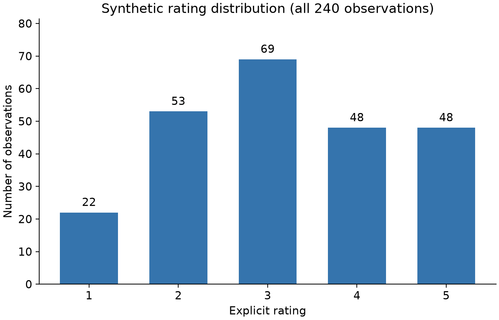
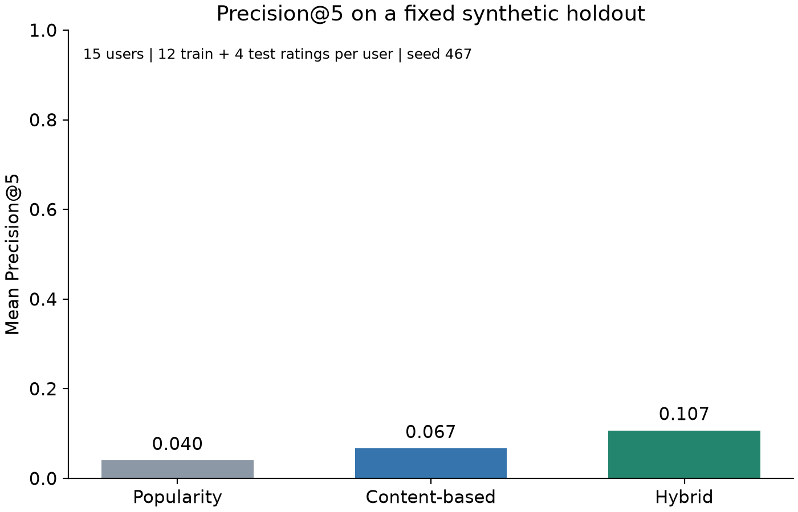

# Wellness Habit and Mindfulness Activity Recommender

- **Student:** Truong Thi Thuy Trang
- **Student ID:** 29201155020
- **Section:** CS467C - Advanced Artificial Intelligence
- **Runtime:** Python 3.11, 64-bit; developed with Python 3.11.9 on Windows

## Problem statement and scope

Students may want a manageable wellness or mindfulness break without browsing a long activity list. This mini-project ranks short activities using a student's stated interests, previous ratings, and journal feedback. It compares an average-rating baseline, TF-IDF content similarity, user-based collaborative filtering, and a sentiment-aware hybrid.

The submission is a small Python terminal application with reproducible evaluation. It includes no website, API, database, deep learning, or external language-resource downloads. TF-IDF is fitted in memory when a catalogue is loaded; no saved model is required. All project deliverables and demo messages are in English.

## Dataset and synthetic-data disclosure

**Every user, rating, and journal entry is synthetic.** The activity catalogue was authored for this educational project. No real participant records, scraped journals, or private information are used.

| File | Size | Schema |
| --- | --- | --- |
| `data/items.csv` | 40 activities | `item_id, habit_name, category, duration_min, description, mood_goal_tags` |
| `data/ratings.csv` | 240 interactions from 15 fictional users | `user_id, item_id, rating, journal_feedback` |

Activities have IDs I001-I040, durations of 5-20 minutes, and semicolon-separated mood/goal tags. There are five activities in each of eight categories: movement, mindfulness, journaling, study recovery, sleep routines, nutrition, social connection, and creative relaxation. Ratings are integers from 1 to 5. Each user rates 16 distinct activities, and every activity has six observations. Of the 600 possible user-item pairs, 240 are observed and 360 are missing: **60% sparsity**. A missing pair does not mean dislike.

| Fictional users | Preference group | Strongest preferences |
| --- | --- | --- |
| U001-U003 | Active students | Movement |
| U004-U006 | Quiet reflectors | Mindfulness and journaling |
| U007-U009 | Focused learners | Study recovery |
| U010-U012 | Social explorers | Social connection |
| U013-U015 | Routine builders | Sleep routines and nutrition |

`src/generate_dataset.py` uses fixed seed **4672026**, category preference scores, personal time budgets, seeded rating noise, and balanced exposure. Feedback for ratings 1-2 is negative, 3 is mixed/neutral, and 4-5 is positive. Eight templates per rating and category-specific context produce 240 distinct full journal strings, but the writing remains template-based. Generation details and preference vectors are available in the source. The original CSV files are reused unchanged by the recommender and evaluation.

Optional dataset commands, separate from running the application:

```powershell
# Validate existing CSV files without changing them.
.\.venv\Scripts\python.exe .\src\generate_dataset.py --validate-only

# Explicitly regenerate the same synthetic dataset only when intended.
.\.venv\Scripts\python.exe .\src\generate_dataset.py --overwrite
```

## NLP methods

`src/nlp_pipeline.py` contains the following transparent methods:

1. Lowercase text, replace punctuation and underscores with spaces, and collapse extra whitespace.
2. Tokenize on whitespace and remove scikit-learn's built-in English stop words and one-character tokens. No stemming, lemmatization, embeddings, or synonym expansion is applied.
3. Combine each activity's name, description, and mood tags. Fit one `TfidfVectorizer` on this catalogue and use that same fitted vectorizer to transform new queries. The name supplements the required description and tags.
4. Compute cosine similarity between activity vectors and a query, another activity, or a weighted mean of previously liked activities. Liked means rating >= 4; history weights are `rating - 3`.
5. Explain matching keywords using shared terms sorted by their actual TF-IDF dot-product contributions. These are lexical explanations, not inferred psychological states.

Sentiment analysis uses small explicit positive and negative word sets. Each matched word contributes +1 or -1. A negator such as `not`, `never`, or `without` within the preceding three tokens reverses that contribution; scope stops at sentence punctuation. The score is the sum of signed evidence divided by the number of matched opinion words, or zero when none match. Positive, negative, and zero scores are labeled positive, negative, and neutral. `analyze_sentiment` also returns the matched evidence, for example `not helpful (-1)`.

This lexicon is an explainable heuristic, not a trained or independently validated sentiment classifier. It cannot reliably interpret sarcasm, complex negation, word sense, or mixed emotions. Synthetic feedback was generated from ratings, so its polarity is not independent ground truth.

## Recommendation methods

All user recommendations exclude activities the target user has already rated. Similar-activity lookup also excludes its source activity. Ties are resolved by item ID for reproducibility. Fewer than five recommendations or an empty result is returned if evidence is insufficient; entries are not invented to fill the list.

| Method | Ranking and explanation |
| --- | --- |
| Popularity | Mean observed rating, requiring at least two ratings per item. Displayed score is on the original 1-5 scale. |
| Content-based | TF-IDF cosine similarity to a free-text query, a source activity, or positive user history. Only positive similarities are returned. |
| User-based collaborative filtering | Pearson similarity on at least two co-rated activities, shrunk by `overlap / (overlap + 2)`. Keep the five most similar positive neighbors. Predict with the target user's mean plus a similarity-weighted average of neighbors' deviations from their own observed means; clip to 1-5. Missing matrix entries remain missing. |
| Sentiment-aware hybrid | Combine content similarity, normalized CF predictions, and normalized mean item-journal sentiment using fixed weights 0.45, 0.40, and 0.15. Positive history weights are additionally multiplied by `1 + 0.25 * journal_sentiment`. |

For the hybrid, a rating prediction `r` is normalized as `(r - 1) / 4`, and a journal sentiment `s` as `(s + 1) / 2`. Missing components are omitted and available weights are renormalized. These scores are heuristic ranking signals, not calibrated probabilities of satisfaction.

Fallback rules are explicit in the terminal output:

- Missing personal positive history: use eligible popularity evidence when no query is supplied. Content/hybrid fallback scores are normalized to 0-1; the fallback reason includes the actual mean rating.
- No usable neighbor or neighbor rating: use the eligible item mean for the CF component. If that is also unavailable, omit the component.
- An item with zero ratings: use matching content without inventing ratings or sentiment; available content weight becomes 1. Such an item cannot be recommended without positive content evidence.
- An unmatched or stop-word-only query: return no supported recommendations rather than silently treating unrelated popular items as textual matches.
- No interactions at all: popularity and CF cannot recommend anything, while matching catalogue content remains usable.

Renormalizing available evidence helps cold-start items but can make their scores less comparable to those of established items. Exact-word overlap can also rank generic study-break text above activities that appear semantically closer to a user's interests. Both behaviors are limitations of this small baseline system.

## Run on Windows PowerShell

The existing `.venv` is ready; no reinstall or environment check is required to run this submission.

```powershell
Set-Location 'D:\01_Projects\cs467-miniproject-29201155020'
.\.venv\Scripts\Activate.ps1

# No arguments runs and saves all three required demo cases.
python src/main.py
python src/main.py --demo-tests

# Personalized recommendations; the default user method is hybrid.
python src/main.py --user U004
python src/main.py --user U004 --method popularity
python src/main.py --user U004 --method content
python src/main.py --user U004 --method collaborative

# Free-text queries default to content similarity; hybrid is also supported.
python src/main.py --query "short evening breathing exercise to reduce exam stress"
python src/main.py --query "quiet reflection and journaling" --method hybrid

# Similar activities and the reproducible holdout evaluation.
python src/main.py --similar I006
python src/evaluate.py
```

Activation is optional: replace `python` with `.\.venv\Scripts\python.exe`. If PowerShell blocks `Activate.ps1`, use that direct executable or permit activation only for the current session with `Set-ExecutionPolicy -Scope Process -ExecutionPolicy Bypass`.

For a **fresh checkout only**, install Python 3.11 64-bit and create `.venv` if it does not already exist. Restore the pinned dependencies locally:

```powershell
py -3.11 -m venv .venv
New-Item -ItemType Directory -Force .tmp | Out-Null
$env:TEMP = Join-Path (Get-Location) '.tmp'
$env:TMP = $env:TEMP
.\.venv\Scripts\python.exe -m pip --isolated --cache-dir .cache\pip install -r requirements.txt
```

The installed core libraries are NumPy, pandas, scikit-learn, SciPy, Matplotlib, NLTK, Jupyter, and joblib. Exact direct and transitive versions are in `requirements.txt`. The application needs no additional packages. `check_environment.py` is the earlier setup smoke check, not part of the evaluation.

## Three required demo cases: actual output

`src/main.py --demo-tests` writes [results/sample_outputs.txt](results/sample_outputs.txt) from live execution. The excerpt below omits only the repeated per-result evidence lines.

1. **Mood query:** the exact required exam-stress query, with five cosine scores and matching terms.
2. **Personal history:** a fictional in-memory user likes a morning-stretching proxy and journaling. The catalogue has no literal morning-stretching activity, so Desk Mobility Break is explicitly identified as a proxy; a second liked movement session makes the active preference explicit. The profile contains I002, I003, and I011, all rated 5, and none can appear in the returned list. This case tests lexical personalization rather than claiming a perfect semantic match.
3. **Cold-start activity:** I041, Evening Breathing and Exam Stress Pause, is appended only to an in-memory catalogue. It has zero ratings. The TF-IDF index is fitted on the expanded 41-item catalogue, and both content-based and hybrid ranking can surface it. Scores differ from Test 1 because the expanded catalogue changes IDF values. Neither the new activity nor the demo profile is written to the dataset.

```text
CS467C - Wellness Habit and Mindfulness Activity Recommender
Synthetic data demonstration; scores are ranking signals, not health outcomes.

TEST 1: Mood query
Query: "short evening breathing exercise to reduce exam stress"

Content-based Top 5 (cosine similarity, 0-1)
1. Comfortable Breathing Pause [I006] | score=0.3981
   Keywords: breathing, stress
2. Consistent Evening Check-In [I025] | score=0.2254
   Keywords: evening
3. Evening Screen Wind-Down [I021] | score=0.2244
   Keywords: evening
4. Tomorrow Preparation Ritual [I022] | score=0.0668
   Keywords: short
5. Campus Loop Walk [I001] | score=0.0608
   Keywords: short
TEST 1 PASSED

TEST 2: Personal history
In-memory user DEMO_STUDENT likes morning stretching and journaling.
The catalogue has no literal morning-stretching item; Desk Mobility Break
is an explicit movement proxy. No existing user is relabeled.
A second liked movement session makes the fictional active preference explicit.
History: I002 Desk Mobility Break = 5; I003 Beginner Bodyweight Session = 5;
         I011 Three Good Moments Journal = 5

Personal-history Top 5 (cosine similarity, 0-1)
1. Desk Reset [I017] | score=0.1511
   Keywords: desk, easy, away, small, task
2. Single-Task Planning Pause [I018] | score=0.1316
   Keywords: step, task, write, pause, short
3. Window View Break [I019] | score=0.1312
   Keywords: break, screen, comfortable, away, study
4. Campus Loop Walk [I001] | score=0.1310
   Keywords: break, comfortable, energy, pace, short
5. Small Win Reflection [I013] | score=0.1171
   Keywords: reflection, confidence, small, task
Example journal sentiment: positive, score=1.000
Lexicon explanation: loved (+1), helpful (+1), refreshing (+1)
TEST 2 PASSED

TEST 3: Zero-rating activity cold start
I041 exists only in memory; the original CSV catalogue remains unchanged.
Observed ratings for I041: 0
Query: "short evening breathing exercise to reduce exam stress"

Content Top 5 (0-1)
1. Evening Breathing and Exam Stress Pause [I041] | score=0.7665
   Keywords: breathing, evening, exam, stress, exercise
2. Comfortable Breathing Pause [I006] | score=0.2777
   Keywords: breathing, stress
3. Consistent Evening Check-In [I025] | score=0.1612
   Keywords: evening
4. Evening Screen Wind-Down [I021] | score=0.1607
   Keywords: evening
5. Tomorrow Preparation Ritual [I022] | score=0.0510
   Keywords: short

Hybrid Top 5 (0-1)
1. Evening Breathing and Exam Stress Pause [I041] | score=0.7665
   Keywords: breathing, evening, exam, stress, exercise
2. Tomorrow Preparation Ritual [I022] | score=0.4480
   Keywords: short
3. Comfortable Breathing Pause [I006] | score=0.4396
   Keywords: breathing, stress
4. Consistent Evening Check-In [I025] | score=0.4392
   Keywords: evening
5. Water Refill Pause [I026] | score=0.4333
   Keywords: (no shared content terms)
TEST 3 PASSED

All three required test cases passed. Demo profiles and new items were not saved.
```

## Evaluation protocol and measured results

`src/evaluate.py` makes one fixed user-wise random holdout using NumPy seed **467**: four observations per user are test data and the remaining 12 are training data. Total sizes are **180 train and 60 test ratings**. Selection is not conditioned on rating value. This is an interaction holdout, not a chronological or unseen-user experiment.

Only training ratings and training journals enter user profiles, the CF matrix, popularity means/counts, and item sentiment averages. TF-IDF may use all 40 public catalogue descriptions; this is a known-catalogue evaluation using metadata, not held-out feedback. No test-driven weight tuning or hyperparameter search is performed. The manual demo profile and new item do not enter evaluation.

For every user and each of Popularity, Content-Based, and Hybrid:

- Rank the same universe of catalogue items the user has not rated in training. Each user has 28 such candidate items. A method's evidence rules, including popularity's two-rating minimum, may reduce the supported list.
- An item is relevant only if its held-out rating is **at least 4**.
- Compute `Precision@5 = number of relevant held-out items in the Top 5 / 5`.
- Average over all 15 users, including users with no relevant held-out items. Lists shorter than five retain denominator 5.
- Unjudged items count as no hit; they are not established negatives. Most unseen catalogue items have no target-user judgment, so this is a conservative offline hit-based measurement.

| Method | Mean Precision@5 | Hits / 75 recommendation slots |
| --- | ---: | ---: |
| Popularity | 0.040000 | 3 / 75 |
| Content-Based | 0.066667 | 5 / 75 |
| Hybrid | 0.106667 | 8 / 75 |

There is one user with no relevant test item; that user remains in the average with zero hits. The test set contains 25 positive judgments, so the maximum measurable mean Precision@5 under this denominator is **0.333333**, even with perfect retrieval of all held-out positives. These are measured Precision@5 values, not accuracy percentages or evidence of real-world wellness effectiveness.

Auditable outputs:

- [evaluation.csv](results/evaluation.csv): aggregate results.
- [per_user_precision.csv](results/per_user_precision.csv): recommendations, held-out relevant IDs, hit counts, and user-level scores.
- [holdout_split.csv](results/holdout_split.csv): exact train/test pair membership.
- [evaluation_summary.txt](results/evaluation_summary.txt): protocol, limits, and the actual metric table.





The rating-distribution plot describes all 240 observations; test labels are used there only for a descriptive figure, not recommendation scoring. Both PNG figures are generated by the evaluation script with labeled axes and values.

## Reflection

**Strengths:** The project provides several working AI recommendation baselines in a small, readable implementation. Shared-term explanations and lexicon evidence are inspectable. User exclusions, cold-start behavior, explicit fallbacks, deterministic splitting, and per-user audit outputs make the results reproducible. Hybrid retrieved more held-out positives than either comparison baseline in this particular run.

**Limitations:** Only 15 fictional users and one split are available. Exposure is artificially balanced, most candidate judgments are unknown, and journals are templated from ratings. Sentiment therefore duplicates part of the rating signal. Lexical matching misses synonyms and can overemphasize generic study terms, as the personal-history example shows. Pearson similarities from small overlaps are unstable despite shrinkage, the hybrid weights are heuristic, and sentiment does not handle complex language. No statistical significance or clinical efficacy is established.

**Possible improvements:** Obtain independently collected, consented feedback; evaluate over repeated user-wise splits or time-based holdouts; use a separate validation split for weight calibration; compare additional baselines; improve text normalization and semantic matching; and evaluate sentiment against independently annotated labels. None of these extensions is claimed as implemented.

**Synthetic-data results do not demonstrate effectiveness for real users.** Activity suggestions are not medical guidance, and the system does not diagnose mood or mental-health conditions.

## Submission structure

```text
data/
  items.csv                 Unchanged 40-item synthetic catalogue
  ratings.csv               Unchanged 240-observation synthetic history
src/
  generate_dataset.py       Existing reproducible dataset generator
  nlp_pipeline.py           Cleaning, TF-IDF, keywords, and sentiment
  recommender.py            Four ranking methods and explicit fallbacks
  main.py                   CLI and three required demo cases
  evaluate.py               Fixed holdout, tables, and two PNG charts
results/
  sample_outputs.txt        Actual output from all three cases
  evaluation.csv            Mean Precision@5 comparison
  per_user_precision.csv    Recommendation and relevance audit
  holdout_split.csv         Reproducible pair membership
  evaluation_summary.txt    Human-readable protocol and scores
  rating_distribution.png
  precision_at_5.png
models/                     Reserved for genuinely fitted saved artifacts; empty
notebooks/                  Reserved; no notebook is needed to run the project
README.md
requirements.txt
check_environment.py        Earlier setup check
```

`.venv/`, caches, bytecode, and temporary files remain ignored by Git. Data, results, and future genuine model artifacts are eligible for submission. This implementation stage does not stage files, create a commit, or push to GitHub; the owner can review and perform Git actions separately.
